# 博富·福美城 —— 移动端客户端（H5）操作文档

> 适用对象：购房客户、置业顾问（分享推广）  
> 版本：2026-11-26  
> 访问：微信内打开 `https://bofu.gdruixiang.com/`；顾问推广链接形如 `https://bofu.gdruixiang.com/?c=分享码`，好友助力链接形如 `.../?i=客户id&c=分享码`  
> 相关文档：[页面布局.md](./页面布局.md)、[功能清单.md](./功能清单.md)

## 1. 进入与授权

1. **微信内打开**活动链接（或扫描顾问二维码）。首次进入微信会自动发起网页授权，用于识别身份、记录来源顾问；拒绝授权仍可浏览，但抽奖、留资、「我的奖品」会再次引导。
2. 活动海报弹窗出现后，可等待 5 秒自动关闭，或点击海报外的遮罩关闭。若距上次打开未超过后台配置的「海报再显间隔」（默认 1 小时），本次不再弹出。

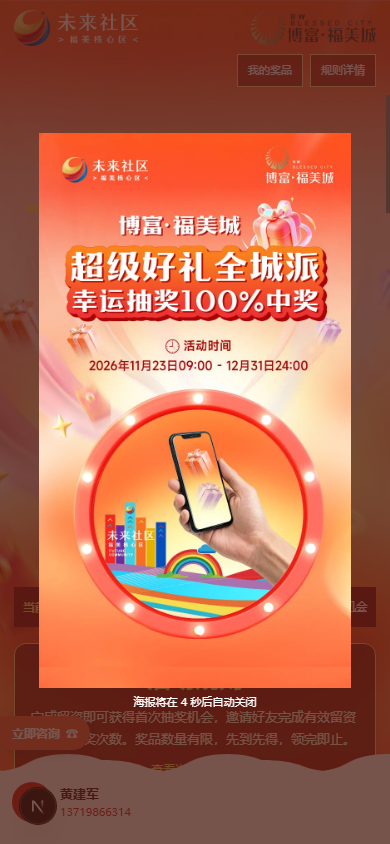

3. 非微信浏览器可以浏览页面，但不能完成微信身份校验；抽奖时会提示用微信打开。
4. 页面结构：**顶部固定**（双 Logo +「我的奖品 / 规则详情」）、**中间可滚动**（公告、抽奖、规则、顾问、奖品、楼盘展示等）、**底部固定**（顾问条 +「立即咨询」）。

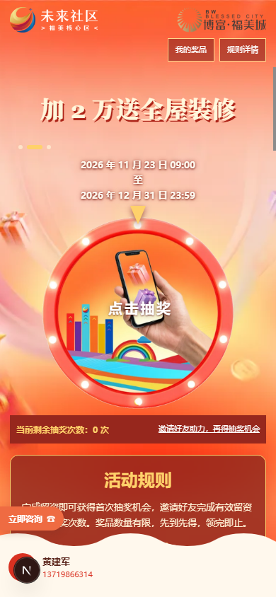

## 2. 首次参与流程（留资 → 抽奖）

1. 阅读顶部轮播公告、活动标题与活动时间。
2. 点击转盘区域开始抽奖。首次抽奖前会弹出**留资表单**：
   - 必填：客户姓名、手机号码（格式 `1` 开头 11 位）；
   - 选填：意向户型、预计到访日期；
   - 提交成功后自动发放首次抽奖次数（默认 1 次，后台可调）。

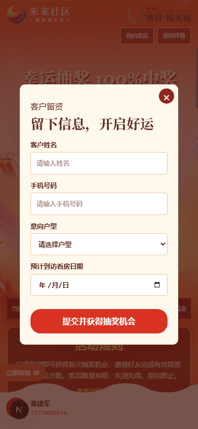

3. 留资完成后再次点击转盘抽奖。转盘**无旋转动画**；点击后播放约 2.7 秒礼盒动画（入场 → 摇晃 → 开盒，开盒只浮出小礼盒不显示奖项），动画结束弹出结果弹窗，展示奖品名称、核销码与兑奖说明。

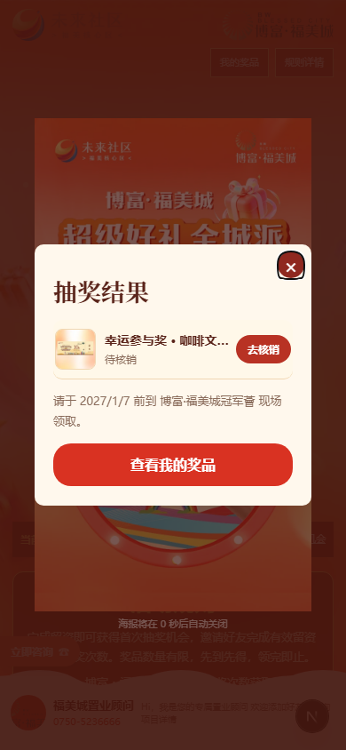

4. 中奖结果弹窗只显示**奖品图片 + 等级·名称 + 「去核销」按钮**；点「去核销」才展开二维码与核销码（含复制）。现场核销密码入口收在展开区内，避免默认视图过密。

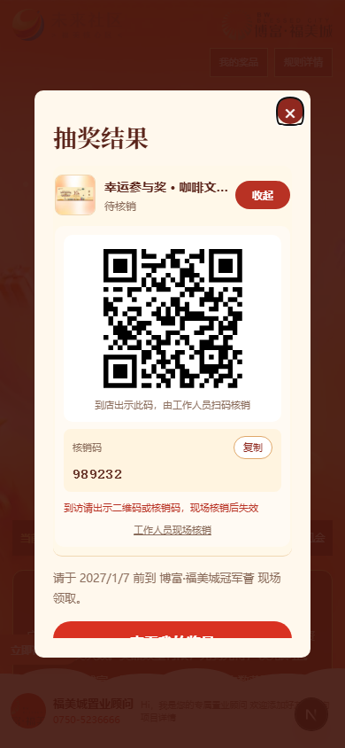

5. 未中奖（兜底奖）时，弹窗会引导「邀请好友助力」再获得次数。

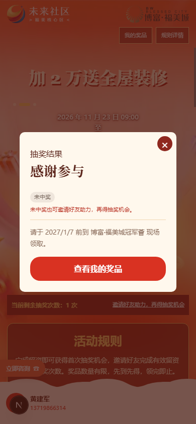

## 3. 页面各区域操作

| 区域 | 可做的事 |
|---|---|
| 活动公告 | 顶部大字轮播，底部指示点显示当前条；内容由后台配置 |
| 活动时间 | 开始/结束分两行显示；活动已结束时整体不显示时间 |
| 抽奖区 | 点击转盘抽奖；显示剩余次数；点助力提示查看邀请说明 |
| 活动规则 | 卡片展示简易文案；点「查看详细规则」弹窗展示后台详细文案 |
| 销售（顾问）卡片 | 查看头像、姓名、电话、介绍文本与微信二维码；点底部顾问条或「立即咨询」可再次打开顾问弹窗 |
| 奖品展示 | 查看各奖项图片、等级、名称、总量/余量；余量约每 30 秒自动刷新，抽奖后与切回前台也会刷新 |
| 咨询与领奖 | 点击热线直接拨号；点地图按后台配置：0 条提示咨询顾问、1 条直接导航、≥2 条弹出「选择地图导航」 |
| 项目亮点 / 楼盘社区 | 图文展示，点击图片放大预览，点空白遮罩关闭 |
| 曝光量 / 参与量 | 页面底部数字展示，只读 |

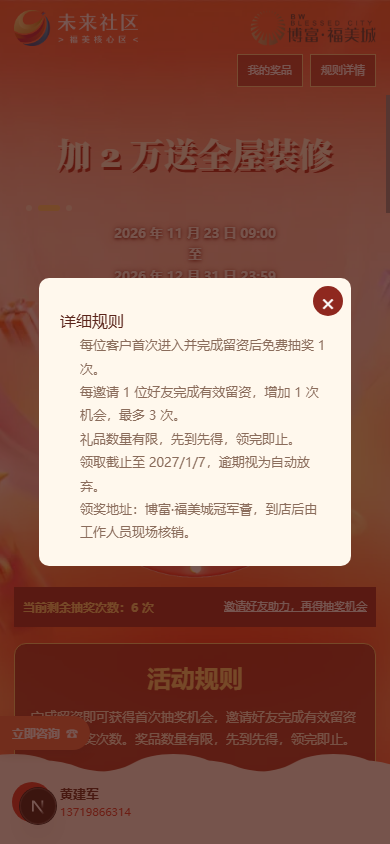

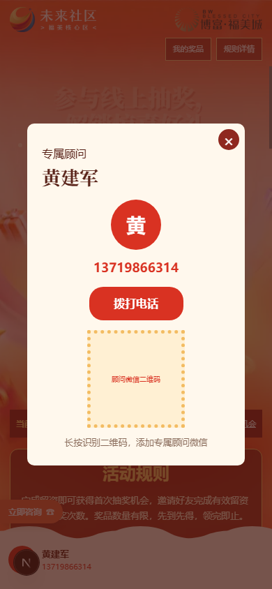

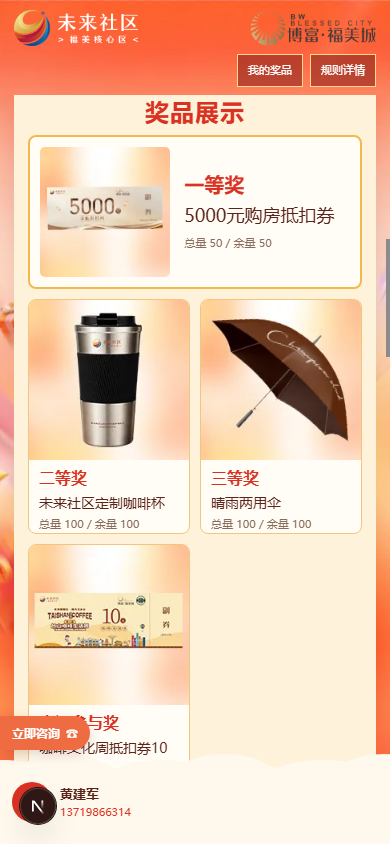

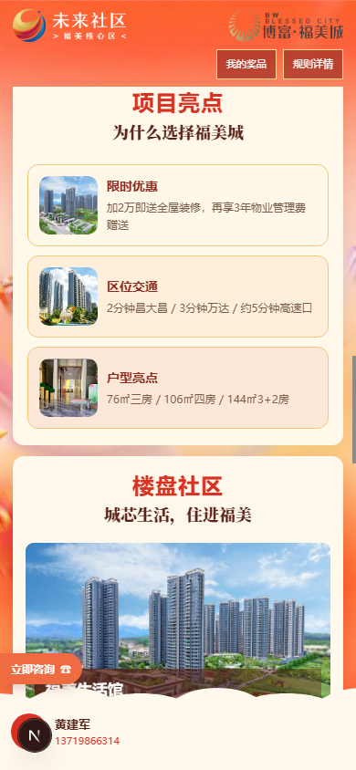

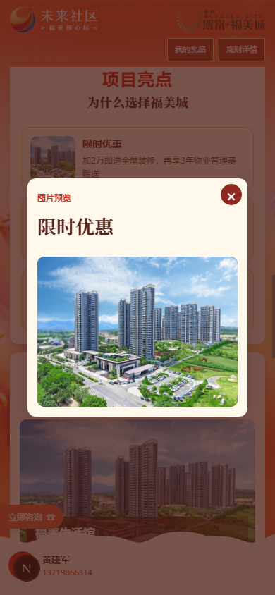

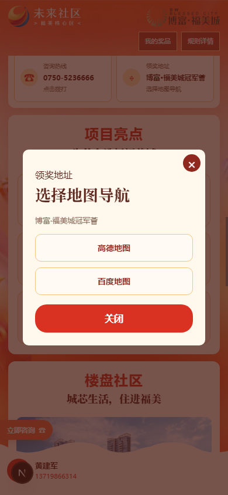

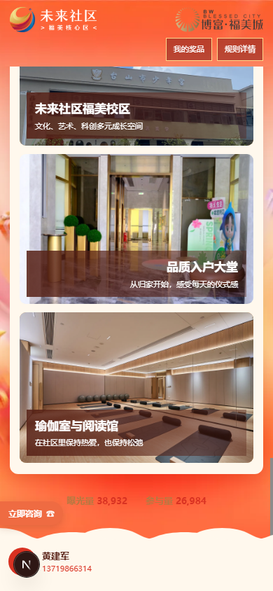

## 4. 我的奖品与现场核销

1. 点右上角「我的奖品」，按 **待核销 / 已核销 / 已失效 / 未中奖** 分组查看历史记录。

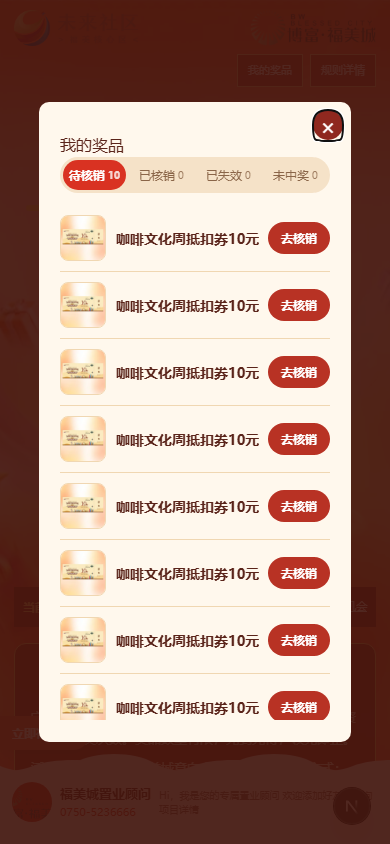

2. 每条待核销奖品只显示**奖品缩略图 + 奖品名称 + 「去核销」按钮**；点「去核销」展开二维码与核销码（4~8 位纯数字，默认 6 位），展开区内可点「复制」复制码给工作人员。

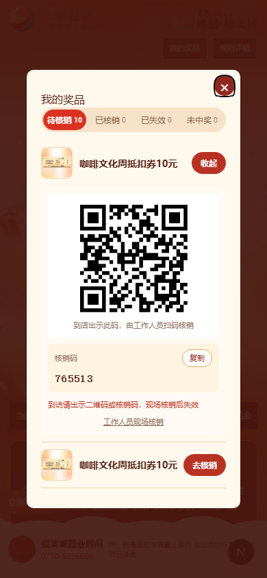

3. 到访售楼部后点「去核销」出示二维码或核销码；工作人员用相机/微信扫码进入核销台，或在后台「客户奖品」核销。
4. 若需在客户手机上直接核销：展开区底部点「工作人员现场核销」，由工作人员输入 4 位核销密码并确认；核销成功后状态变为「已核销」，核销码失效，请勿重复发放奖品。

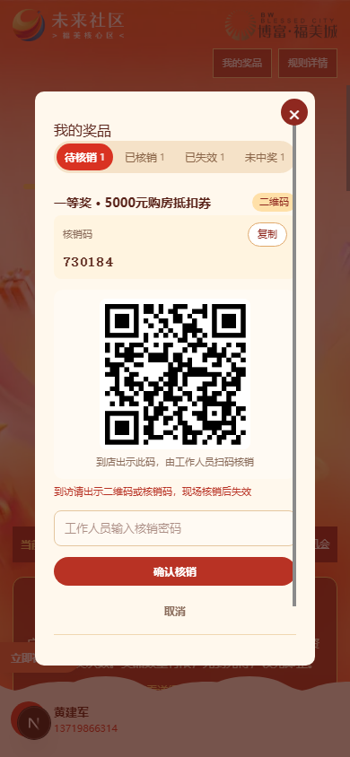

5. 超过兑奖截止时间的奖品会显示「已失效」，不能核销。

## 5. 邀请好友助力 / 分享

1. 在抽奖区或助力弹窗点「邀请好友助力」，复制专属助力链接（`/?i=客户id&c=分享码`）发给好友，或在微信中直接分享给好友/朋友圈（群聊由微信转发机制决定）。

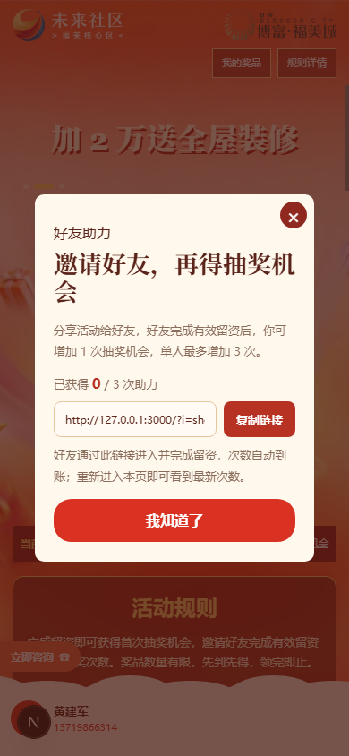

2. 好友通过链接打开并完成**有效留资**（姓名 + 合法手机号）后，邀请人获得加次（默认 +1，上限默认 3 人）。
3. 一层助力：只有直接邀请人加次；同一好友对同一邀请人只生效一次；本人不能给自己助力；达到上限后不再加次并提示。

## 6. 常见问题

| 现象 | 处理 |
|---|---|
| 点击抽奖提示「请先授权」 | 在微信内重新打开链接并允许网页授权；取消授权不影响浏览但无法参与 |
| 提示「请先留资」 | 先完成姓名 + 手机号留资，再抽奖 |
| 提示抽奖次数不足 | 通过邀请好友助力获得次数；每日/活动期上限由后台配置 |
| 分享给好友时显示的是 URL 链接 | 需运营在公众号后台配置 **JS 接口安全域名**（含 `bofu.gdruixiang.com`）与服务器 IP 白名单；配置后标题/摘要/封面才会生效 |
| 核销码是一串字母数字 | 历史数据为旧格式；可出示给工作人员从「线索详情 → 客户奖品」核销，新抽奖生成的码均为 6 位数字 |
| 奖品余量与实际不符 | 余量约 30 秒刷新一次；抽奖成功或切回前台会立即刷新 |
| 地图导航显示「请咨询专属顾问」 | 后台未配置地图链接，属于正常展示 |
